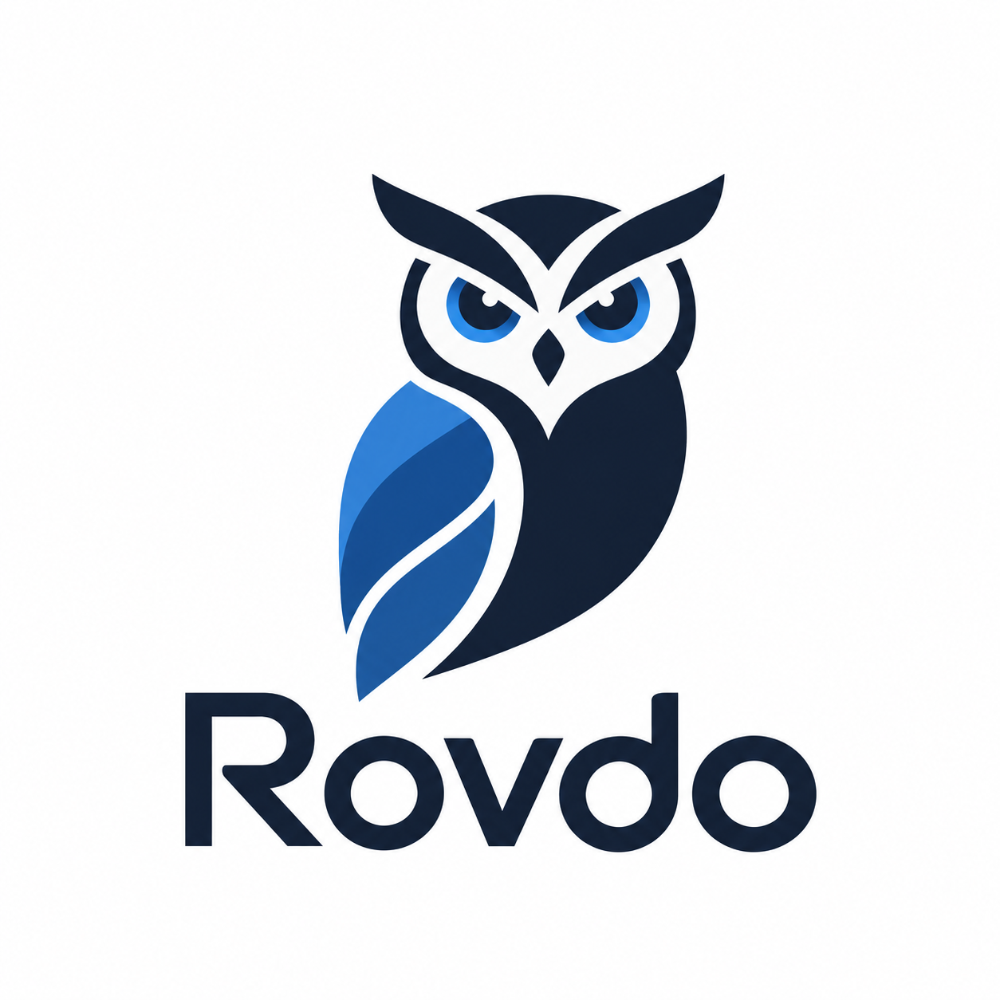

# Rovdo

<p align="center">
  <picture>
    <source media="(prefers-color-scheme: dark)" srcset="apps/desktop/src/renderer/assets/inverted_rovdo_logo.png" />
    
  </picture>
</p>

A local-first, open-source desktop workspace for AI-assisted browser workflows, with bring-your-own-model support.

Rovdo is being built to help users discover relevant jobs, prepare fact-grounded application documents, and review browser actions before submission. Its discovery engine uses deterministic qualification matching, filters and local search without requiring an AI key. Optional model-assisted work uses a provider selected by the user.

**Status: v0.3.8 - Pre-Phase 4 Stabilization.** Discover jobs beyond a saved employer directory using public APIs, feeds, internship lists and a permitted search index, then rank complete records without AI. Existing Greenhouse, Lever, Ashby, SmartRecruiters and public JSON-LD integrations remain available. Maintain a verified candidate profile and save opportunities. Optional BYOK models support streaming chat, advisory shortlist review and scoped browser tasks with human approvals. Document generation and application submission are planned for later milestones.

## Quick start

Prerequisites:

- Node.js 24 LTS and npm 11. The minimum supported Node version is 22.23.2.
- Git and a graphical desktop session on Windows, macOS, or Linux.
- Internet access for dependency installation and the first Electron binary download.

```sh
git clone https://github.com/hamzavaid/Rovdo.git
cd Rovdo
npm ci
npx playwright install chromium
npm run dev
```

The app opens the workspace overview without a Rovdo account or environment file. Saving API profiles does not make a model request; connection tests, chat and browser model requests require explicit consent. CLI discovery uses local version commands and may query the installed Ollama server.

`npm run dev` builds the application and launches Electron. Restart it after source changes. To launch an existing build:

```sh
npm start
```

The build is a local development application, not an installer or signed release.

## Connect a model and chat

1. Open **Models & Privacy → New profile**. Choose a provider, enter a model ID available to your account, and set output-token and timeout limits. Hosted providers use their official endpoints. Compatible endpoints accept public HTTPS URLs or explicit loopback URLs such as `http://127.0.0.1:11434/v1`.
2. Enter the current input/output USD rates per million tokens, optional cached-input rate, and a pricing version or date. Save the profile. Rates are user maintained; no model names or prices are treated as permanent defaults. Pricing is optional for connection tests and required for budgeted chat. Use zero only for a verified free endpoint.
3. Choose **Enter API key securely**. A native password dialog sends the value directly to the privileged process and OS vault. There is no API-key input or read-key API in the web renderer. For a compatible server that requires no authentication, select **This compatible endpoint does not require an API key** instead.
4. Review the saved destination, approve the small connection-test prompt, and click **Test connection**. The test requests the read-only `workspace_info` tool with at most 128 output tokens and may incur API charges. Streaming, tools, and usage are detected from actual responses; untested features remain unknown.
5. Open **Chat**, select the profile, and set an estimated spend limit. Write a message, expand **Review outbound conversation**, and approve transmission before sending. Use **Stop response** to cancel or **+ New chat** to discard in-memory context.

Chat supports text and bounded tool-call roundtrips. The only executable tool is `workspace_info`, which returns public application metadata. Model output cannot execute browser actions, shell commands, or arbitrary tools. Rendering treats responses as text.

Failed or stopped exchanges are excluded from later model context. Requests are never silently replayed; retry explicitly after resolving an error. Rate-limit `Retry-After` cooldowns are honored. Editing a destination invalidates capability results and removes its old key; enter a new key and test again.

Usage distinguishes reported tokens from unavailable accounting. Cost estimates use the saved pricing version and separate cached-input rates. Missing rates, unsupported cache-write pricing, or absent provider usage produce an unavailable estimate. Budget preflight uses a conservative token estimate and bounds tool rounds; it is not a guarantee of the provider's final bill.

## Connect an installed AI CLI

Open **Models & Privacy → Connect your CLI**. Rovdo checks fixed executable names on PATH and common Windows/macOS/Linux installation paths when you open model settings; **Refresh CLIs** rescans. It never installs, updates, signs in or opens a login page automatically. Install/authenticate the CLI yourself using its official instructions. Credentials remain managed by the CLI; environment-only API credentials are deliberately not forwarded by Rovdo.

| CLI | Current integration |
| --- | --- |
| Claude Code | Restricted text chat on the documented 2.1.248+ version range within 2.1.x; all built-in/MCP tools, hooks, skills and session persistence disabled. Other versions are unavailable until reviewed. |
| Ollama | Installed model discovery via `ollama list`; text chat reuses Rovdo's compatible API at `127.0.0.1:11434/v1`. Start the server and install models separately. Rovdo never pulls a model. |
| OpenAI Codex | Restricted text chat for **0.165.0 only**. Tools, hooks, skills, user configuration and session persistence disabled; read-only sandbox and no approvals remain enforced. Other versions require another isolation review. |
| Gemini CLI, Qwen Code | Installation/version detection and saved model preferences; **restricted chat unavailable**. Their full tool/configuration isolation has not been verified here, so Rovdo does not run unrestricted inference. |

Codex retains its existing login; Rovdo never reads or copies its credentials. Codex **Default** uses the CLI's built-in model because user configuration is ignored; select a custom model ID if needed. Global `~/.codex/AGENTS.md` and `AGENTS.override.md` must be absent or empty: the reviewed CLI still loads them despite ignoring user configuration, so Rovdo refuses inference when either contains content. Rovdo never modifies those files. Refresh, save your model, then explicitly approve **Test** before selecting Codex in Chat. Text responses and reported token counts are supported; token streaming, vision, structured output and tool calling are not claimed. Read-only alone is insufficient to prevent file reads: the fixed tool/configuration restrictions are essential.

The opt-in native isolation test uses a temporary credential-free home and a hostile **local mock Responses server**, never a paid provider. In PowerShell, set `$env:ROVDO_CODEX_VERIFY_EXECUTABLE` to the absolute installed `codex.exe` path, then run `npx vitest run apps/desktop/src/main/codex-native.test.ts`. On macOS/Linux, export the same variable pointing to the native executable. The native check has been run on Windows with 0.165.0; other platforms still need native verification. Normal CI also tests mock Codex detection, restrictions, version changes, context, usage, settings and Electron chat.

Expand **Configure**, keep **Default** or choose a discovered/custom model ID, then save. Claude Default copies only the bounded `model` preference from `~/.claude/settings.json` into restricted mode; hooks, helpers and other user/project settings are not loaded. Without that preference, the CLI selects its default. Ollama has no configured chat default, so it uses the first alphabetically listed installed model. Ollama custom IDs must already appear in its installed list. Other CLIs do not have an assumed universal model-list command. Preferences and tested sharing permissions persist locally. An unchanged tested CLI/model reconnects after local detection on restart without an inference request. Executable/version, effective model or reviewed isolation-policy changes invalidate approval and require a new test and authorization. A failed test blocks chat until a successful re-test; it does not discard permission choices for the unchanged identity.

**Test** shows the exact small prompt and requires approval. Tests are cancellable and bounded to 20 seconds. After success, choose **Chat messages** and optionally **Selected files and folders** in the permissions dialog. Select **CLI · …** in **Chat**; ordinary messages use this remembered approval. **Manage access** in Chat or **Manage permissions / Revoke access** in Models & Privacy changes or removes it. Changing permissions clears that conversation. Review the outbound conversation at any time. Only completed exchanges are carried forward; stopping cancels the process/request. CLI connections accept text and selected text snapshots, without browser, shell or filesystem tools, vision or structured-output claims. Streaming is marked tested only when observed.

**Local executable does not mean local inference or free usage.** Claude and the other hosted CLIs may send content to remote services configured outside Rovdo; Ollama may use local or cloud-backed models. Subscriptions, usage limits and charges can apply. CLI cards/chat display **Cost unknown / managed by CLI**; Rovdo's API spending limits are not enforced for CLI usage. Rovdo adds no credentials, repository contents, candidate profile or jobs automatically. Explicitly attached content is sent as reference text; inspect it for secrets before sending. CLI-managed account identity is opaque to Rovdo: executable/model trust cannot detect an account switch inside the CLI; revoke approval when changing accounts or remote CLI configuration. CLIs remain trusted installed software, not OS-sandboxed untrusted programs.

Interface references: [Claude CLI flags](https://code.claude.com/docs/en/cli-reference), [Codex CLI](https://developers.openai.com/codex/cli/reference), [Gemini policies](https://geminicli.com/docs/reference/policy-engine/), [Qwen settings](https://qwenlm.github.io/qwen-code-docs/en/users/configuration/settings/), [Ollama compatibility](https://docs.ollama.com/api/openai-compatibility). Existing API profiles, budgeted tool chat and browser workflows remain available separately.

### Chat attachments and local dictation

Chat keeps its model selector and **+ New chat** above the scrollable conversation, with the composer at the bottom. **Enter** sends; **Shift+Enter** inserts a line break. API profiles retain per-message consent and estimated spending limits; CLI costs remain unknown/managed by the CLI.

Use **+ > Choose files / Choose folders** to select multiple local items through native pickers. Remove chips before sending or expand **Review outbound conversation** to inspect the exact text. Text/code files, PDF and DOCX are supported; images and binary attachments are unavailable. Selection snapshots are memory-only, expire after 30 minutes, and are bounded to 20 files, 5 MB source bytes per selection and 64 KB combined extracted text. Folder traversal is bounded; hidden entries, dependency/build trees and symbolic links/junctions are excluded. Oversized selections fail explicitly rather than silently truncating. PDF/DOCX extraction uses the existing isolated document worker. Selected folders grant a bounded snapshot, never ongoing access or CLI filesystem tools. Removing unsent chips or starting a new chat discards their capabilities. Sent reference content remains visible in the current in-memory conversation until reset.

The microphone beside Send offers optional offline dictation on **Windows with an installed System.Speech-compatible recognizer and desktop microphone permission**. Approve microphone use, then start/stop listening; text is added to the draft and never sent automatically. Listening stops when sending, resetting, leaving Chat, or closing Rovdo, with a five-minute session limit. Missing recognizers, microphone denial and unsupported systems leave typing available. Rovdo does not record/upload audio and has no remote transcription fallback; macOS/Linux dictation is currently unavailable. See Microsoft's [desktop recognition engine documentation](https://learn.microsoft.com/en-us/dotnet/api/system.speech.recognition.speechrecognitionengine.-ctor?view=netframework-4.8).

## Workspace navigation

The sidebar groups implemented tools into **Workspace** (Overview, Chat, Browser), **Career** (Jobs, Profile), and **Settings** (Models & Privacy, Discovery & imports). Overview shows actual indexed jobs, saved opportunities, source health, model readiness, recorded collection/browser activity and API usage. **Review saved opportunities** opens Jobs with Saved only selected. Loading or unavailable data is identified explicitly. Pending actions show progress and prevent duplicate submissions; ongoing job collection identifies the sources being processed.

Light / Dark / System appearance applies across all workspaces and persists locally. Keyboard users can skip to content and use native buttons, disclosures and labeled controls. Chat prioritizes its conversation and bottom composer; **Budget & destination** exposes request limits. The first-model guide walks through configuration, the OS vault and an explicitly approved connection test.

## Browser workspace

Open **Browser**, choose a tested model and enter a task, start URL, then expand **Scope and safety settings** to enter exact allowed HTTPS origins and visible text that will verify completion. Review the model destination and consent to sharing bounded page observations. A separate Chromium window opens with a fresh session. Review each proposed click, fill or selection before approving it; use **Pause** or **Stop** from Rovdo at any time.

The timeline persists verified action metadata and costs. Input values are excluded from observations and audit events. After a restart, interrupted runs pause for reconciliation; resuming opens a fresh browser without replaying past actions. CAPTCHA and MFA prompts pause for human review. The current browser worker supports public, read-only navigation and reversible DOM steps; final submissions, browser network writes, login credentials, uploads, downloads and screenshot retention are disabled. Authenticated session reuse and application submission belong to later milestones.

Default limits are 20 actions, 50,000 tokens, an estimated $0.50 and five minutes per UI run. **Execution limits** permits bounded changes within the existing runtime policy. Editing task settings revokes consent. Missing model accounting stops continuation. Cost estimates are subject to provider billing and cannot guarantee the final charge.

## Candidate profile and job discovery

1. Open **Profile**, choose Skills, Experience, Education, Projects or Identity & eligibility, and add facts with an evidence reference or explicit assertion, check each fact you verify, and save. Unverified facts do not affect matching. Legal work authorization and citizenship must be your own assertions. Use **Preferences** for roles, exclusions, locations, work modes, seniority levels and salary preferences; ranking configurations are selected in Jobs. Under **Imports**, import a local PDF, DOCX, TXT, Markdown or structured JSON profile, paste your LinkedIn content, or choose your LinkedIn archive ZIP. Public GitHub imports read repository metadata, languages and README files only after consent. Edit the preview, select qualifications to verify, and merge; verified originals are preserved. Citizenship, authorization and clearance need separate explicit confirmation. Scanned PDFs require text or a different source; OCR is not included.
2. Open **Jobs** and choose one of three scopes. **Search All** is the default: discover public jobs and employers dynamically, guided by verified skills, experience, projects, education and role/location preferences. **Search All Saved Companies** keeps the original approved-directory behavior (the starter directory contains Figma, Palantir Technologies, Linear and SmartRecruiters). **Selected company** collects due feeds from one saved employer. Disabled sources remain disabled; **Apply filters to cached jobs** searches retained results without collecting. Older saved searches retain their saved-company scope. Global discovery never automatically grants discovered employers permission to join scheduled saved-company polling.
3. Results appear as sources finish. Use **Refresh employer feeds** in the search section to collect due verified feeds. Rovdo also checks due saved sources each minute while running; global work advances in bounded batches while running. It respects persisted deadlines, one request per second per ATS origin, Retry-After cooldowns, bounded pages and failure backoff. Public reads require no model or private recruiter credentials. Source health distinguishes failures, empty feeds and searches with zero matches.
4. Search and expand **Advanced search filters** for role family, internship season, graduation window, experience level, location/remote jurisdiction, work mode, published annual salary/currency, posting age, minimum score and eligibility outcome. Unknown salary or posting dates do not pass explicit numeric/freshness filters. Graduation filtering retains unspecified windows for review. Filters narrow results without changing the candidate profile or ranking configuration. Results show a bounded score, verified skill matches, explicit gaps, tri-state eligibility evidence, provenance and scoring/profile versions. Choose qualification, newest, salary or company ordering and browse in pages of 50. Employment type, source and verification filters are also available. Salary sorting uses published numeric amounts without currency conversion; use the salary-currency filter when comparing amounts. Save named searches, mark jobs relevant/irrelevant, record an applied marker, or mark postings as read. Feedback and applied markers never change technical qualification scores or submit an application. Hard failures are excluded by default; unknown requirements stay visible for review. Possible duplicates need review, while identical canonical targets are merged with their provenance preserved.
5. Save opportunities independently of any model. For optional AI notes, choose **Preview optional AI review**, select a model, review the exact outbound facts/job excerpt and destination, and approve transmission. UI reviews one saved job with an estimated $0.10 cap; the service supports at most five. Advisory notes cannot alter eligibility, ranking or source facts. Reviews are cached by content, profile and model versions.

### Global discovery coverage and controls

Expand **Sources, queries and collection settings** to select sources, inspect capability/policy limitations and preview technical search queries. Per-source keyword/location overrides guide supported API searches and collection priority; result filters remain separate. Search never uses a model, and query planning excludes contact details, legal assertions and raw profile documents. With no verified profile, discovery uses a broad generic query and still collects accessible feeds.

| Integration                               | Working behavior                                                                     | Limitations                                                                                                            |
| ----------------------------------------- | ------------------------------------------------------------------------------------ | ---------------------------------------------------------------------------------------------------------------------- |
| Greenhouse, Lever, Ashby, SmartRecruiters | Resolve discovered public application URLs into employer-scoped API feeds            | No universal ATS endpoint; unknown employer identity stays unverified                                                  |
| Public employer JSON-LD                   | Read permitted `JobPosting` metadata and known ATS links                             | Robots checks, same-origin posting validation, no scripts/browser scraping                                             |
| Himalayas / Remotive                      | Public job APIs, pagination/cache, complete records through the existing scorer      | Cached/delayed data; supplied application links and visible source credit retained; redistribution exports disabled    |
| We Work Remotely                          | Public RSS with retained descriptions and source URLs                                | Aggregator availability remains unverified until employer evidence is available                                        |
| Four GitHub internship/new-grad lists     | Application-column links from public repository tables                               | Incomplete links remain unscored leads until a complete public posting resolves                                        |

Keyless archive indexes and public feeds discover employers beyond the saved directory. Historical URLs require live verification. Policy restrictions, public-address checks, robots rules, authentication challenges and rate limits still apply. Search-engine HTML scraping, CAPTCHA solving, authentication bypass and automatic redirects are disabled. Only explicitly supported adapters appear in the source registry.

The collection panel reports discovered companies, sources searched, unique jobs collected, definite filtered jobs, pending work, quarantined rows and source errors. These are coverage statistics for selected accessible sources, **not every job on the internet**. Partial results appear before all sources finish. Pause, resume or cancel collection; checkpoints, queries, cached responses and collected jobs persist locally. Interrupted runs pause at restart rather than silently resume outbound requests. Concurrent searches have independent queues and share per-origin throttling. A task stops after five consecutive transient failures; start a new search to retry a recovered source.

There is no total jobs/employers/results ceiling. Safety bounds apply to individual response bodies, pages, file imports, concurrent requests and scoring batches. Large result sets are paginated and scores warm incrementally; the UI identifies pending scoring. Unresolved discovery previews show the latest 20 leads, separately from all scored results. Public feeds are cached (Himalayas 24 hours, Remotive 6 hours, others 1 hour); these are not live availability guarantees. Source-specific records remain stored, duplicates retain provenance, and authoritative employer fields take precedence over aggregator fields.

Use **Export page CSV** or **Export page JSON** for the current result page, including scores and application URLs. Source-restricted records are omitted with an explicit count; candidate contact information is not exported. CSV cells are protected against spreadsheet formulas. Job imports stay unverified, never visit their listed websites, and never invent missing employer names, descriptions, dates or compensation. Incomplete imported rows remain unscored discoveries.

Public API usage follows the [Himalayas documentation](https://himalayas.app/docs/remote-jobs-api) and [Remotive API terms](https://github.com/remotive-com/remote-jobs-api); archive company discovery follows the [Wayback CDX API](https://github.com/internetarchive/wayback/tree/master/wayback-cdx-server) and [Common Crawl index API](https://index.commoncrawl.org/). Automated tests use fixtures, not paid providers or real job applications. Live provider availability and individual site permissions still require operational review.

### Choose a ranking method

Open **Jobs / Ranking & matching / Ranking preset**, select a method, then **Use as default ranking**. The default persists locally; selecting a preset for inspection does not change the active ranking.

| Preset                    | Purpose                                                                                                                                               |
| ------------------------- | ----------------------------------------------------------------------------------------------------------------------------------------------------- |
| Legacy v1                 | Original deterministic-v1 scoring and 35/20/15/20/10 weights                                                                                          |
| Technical Balanced v2     | Requirement-centric skills/experience/projects/seniority/role/depth/education/lexical weights of 30/19/14/10/8/7/4/3, normalized over active criteria |
| Technical Conservative v2 | Stronger verified-evidence thresholds and direct requirements                                                                                         |
| Technical Lenient v2      | More project and curated transferable-skill credit; hard legal restrictions still apply                                                               |
| Opportunity Hybrid        | Separate opportunity-fit method including location, salary and company preferences                                                                    |

Technical Skills uses searchable category chips with verification indicators. Select a chip to open a centered editor for practice depth, optional self-assessed proficiency, evidence and verification; **+ Add** opens evidence-backed entry. Experience, education, projects and certifications use compact searchable rows. The close button or Escape returns to your workspace. Save candidate profile to persist edits.

Structured qualification records expose source evidence and editable fields. Editing clears verification; explicit re-verification adds a user assertion without deleting the original evidence. Save candidate profile to persist the revised record.

Custom weight controls pair 0-100 sliders with number inputs. Optional **Auto-balance weights** redistributes other components automatically; **Normalize to 100%** normalizes an under-allocated draft. Confidence and coverage inputs are percentages while stored values retain their original scale. **Allocation preview** shows normalized component shares; **Preview saved ranking** compares real indexed jobs using saved configurations. Unsaved edits are not used in job-score previews. In manual mode their combined total cannot exceed 100; reduce one weight before increasing another. Saving requires a total of exactly 100. Existing relative weights are shown as percentage drafts without changing stored scores until you save. Threshold and gate descriptions explain shortlist rules and eligibility checks.

Built-in presets are immutable. Select **Clone selected ranking** beside **Use as default ranking**. The clone is automatically named `Name_clone` (with a numeric suffix if needed), selected, and opened for editing. Only custom/created configurations can be renamed; built-in names remain read-only. Edit its name, valid component weights, required/preferred multipliers, evidence floor, gates and shortlist thresholds; save and optionally make it the default. Renaming preserves revision history. Deleting a custom default returns to Legacy v1. Only components belonging to the selected method are editable. **Create technical ranking** starts from Balanced with an automatic clone name. Import/export configurations as copyable JSON under **Manage ranking profiles**; imports receive a new identity and never overwrite an existing profile. **Reset custom configuration to preset** creates a new revision while preserving the custom name. Job cards can compare the selected ranking with another built-in or custom method against the same evidence; scores from different methods are not probabilities.

Technical scores use job requirements and bound verified evidence, not the number of skills on a resume. Related technologies are not automatically interchangeable. Missing evidence stays unknown; missing job criteria are inactive. Job details show normalized contributions, required-skill coverage, source excerpts, evidence IDs and algorithm/configuration versions. Preference fit and eligibility remain separate from technical qualification. BM25 retrieves jobs and does not dominate qualification scoring. [Taxonomy scope and primary references](packages/career/TAXONOMY.md).

Assessment completeness is separate from score, confidence and eligibility. Unsupported mandatory clauses remain visible for review; unpublished requirements do not imply full coverage. Unresolved material legal conditions prevent automatic shortlisting. Hard locations use normalized country/region comparisons; ambiguous jurisdictions remain UNKNOWN. Legacy v1 retains its original weights, with the same legal and expired-posting safeguards. Selecting **Eligibility: FAIL** while hiding excluded jobs displays a remedy to show those jobs explicitly.

Job identity updates merge canonical duplicates transactionally, retaining saved opportunities, applied markers and source history. Conflicting relevance feedback is displayed for explicit resolution. Existing databases migrate additively; custom ranking presets are retained. Cached collection results retain their original observation times, and explicit posting expiration is separate from temporary network failures.

Import limits are 5 MB per local file and bounded decompression/text extraction. Text heuristics currently recognize English section/date patterns; review every preview. Public GitHub imports are limited to ten repositories in the UI (twenty through the validated service), respect persisted rate limits and stop after sixty seconds. Stars, forks and timestamps do not prove authorship, proficiency or employment duration. Imports and profile review drafts are stored locally in unencrypted SQLite; no document is sent to an AI provider by importing it.

Provisional hand-authored comparison fixtures measure Precision@10/NDCG@10 for regression analysis. Independent recruiter validation is pending. Research-derived weights are configurable starting points, not validated accuracy claims.

### Source coverage and reliability

The directory stores stable employer identities/aliases, board identifiers, provenance, policy status, verification hashes and refresh dates. **Verified source directory** shows coverage and health. Expired verification metadata on approved sources is refreshed during Search All Saved Companies; policy blocks and user opt-outs are preserved. An unsuccessful refresh cannot erase cached or saved jobs.

**Discover another permitted employer source** accepts a public careers URL or supported board URL and a reviewed access-policy reference. With your explicit permission it checks robots restrictions, reads one bounded page, and validates up to three supported feeds or same-origin `JobPosting` JSON-LD records. It does not recursively crawl or open restricted platforms. Manual tenant registration remains under **Advanced Source Management**. Workday is not enabled: no documented, authorized employer-specific integration was supplied, and there is no assumed universal Workday search API.

Collection uses at most three concurrent origins (hard maximum four), serial requests within each origin, persisted quotas, a two-minute source budget, bounded pages and Retry-After handling. SmartRecruiters uses documented company listing/detail routes with bounded paging. Invalid individual records are quarantined; partial snapshots cannot mark missing jobs closed. Empty feeds, failures and zero matching results remain distinct. Canonical company aliases and exact requisition/URL deduplication retain normalized source-specific records and provenance; approximate title/location duplicates remain flagged for review.

SQL applies structured filters and paginates after cached score ordering. Unchanged listing text avoids FTS rewrites. Qualification scores are reused across filters/searches; cache keys bind job content and eligibility state, candidate evidence/preferences, taxonomy/parser/scorer and ranking configuration. Time-dependent evidence (ongoing employment, graduation, expiring certifications) also binds the evaluation date. Legacy v1 retains its query-dependent BM25 behavior and may rescore when that lexical input changes. Search feedback does not train or alter the scorer.

### Appearance and accessibility

Use **Appearance** in the top bar to select **Light**, **Dark**, or **System**. The setting persists locally across restarts. System follows OS appearance changes automatically. Semantic colors apply to navigation, profiles, imports, search, cards, ranking, chat, models, browser controls and application dialogs; branding switches to the existing light/dark owl assets. Native window decorations and external OS dialogs remain subject to platform capabilities; the Windows credential dialog body follows Rovdo's selected appearance without exposing keys to the renderer.

Controls have labels and visible keyboard focus, a skip-to-content link, reduced-motion support and responsive layouts. Desktop tests cover both palettes, WCAG AA text contrast for semantic color pairs, keyboard operation and live System changes; hosted cross-platform/native-dialog appearance still needs CI/manual validation.

Polling uses transactional page checkpoints and resumes interrupted cursors. Complete snapshots alone count toward the removal grace period; outages do not remove accepted or saved jobs. Conditional caching is used for whole-board responses when offered. Paginated Lever responses are read page by page, without assuming a page ETag validates the whole board. Source opt-out is checked again before accepting a response.

Eligibility extraction is deliberately conservative and supports a versioned set of explicit phrases; unsupported legal/education terms require review. Missing facts never become invented qualifications. Match scores are deterministic indicators, not a guarantee of suitability or legal eligibility. The synthetic 1,000-job corpus measures repeatability and known fixture labels, not live coverage or real-world accuracy. Candidate data is stored locally in SQLite; whole-database encryption is not claimed.

## OS credential vault requirements

- **Windows:** Windows Credential Manager; native entry uses Windows Forms through the built-in Windows PowerShell. No key is passed in process arguments or environment variables.
- **macOS:** Keychain and a native hidden-answer password dialog.
- **Linux:** an unlocked Secret Service vault (for example, GNOME Keyring) and Zenity for native entry. No in-memory-keyring or plaintext fallback is used. Compatible profiles explicitly configured without authentication do not need a vault.

On Ubuntu, install native entry/vault support with `sudo apt-get install gnome-keyring zenity dbus-x11`. Run inside a graphical desktop session with a session D-Bus and unlocked keyring. An unavailable vault is reported visibly and blocks credential-dependent requests.

An optional HTTPS CONNECT proxy can be configured without embedded credentials. TLS verification stays enabled. Authenticated proxies and provider-specific transports beyond the common text/function-tool API are not supported in this preview.

## Development commands

| Command              | Purpose                                                                                    |
| -------------------- | ------------------------------------------------------------------------------------------ |
| `npm run dev`        | Build and open the desktop application                                                     |
| `npm run build`      | Compile renderer, main process, preload and bounded import worker into `apps/desktop/dist` |
| `npm run lint`       | Lint source and configuration with zero warnings allowed                                   |
| `npm run typecheck`  | Check strict TypeScript contracts                                                          |
| `npm test`           | Run Vitest unit and boundary tests                                                         |
| `npm run test:watch` | Run unit tests in watch mode                                                               |
| `npm run test:e2e`   | Verify Electron isolation, native-vault use, settings restart, and mock-provider chat      |
| `npm run check`      | Run lint, typecheck, unit tests, build, and desktop smoke                                  |

Build before running E2E tests directly. Playwright drives Electron and isolated Chromium fixtures; install Chromium with `npx playwright install chromium`. Tests use synthetic credentials in the real OS vault and remove them afterward. Provider HTTP responses are mocked or served by an explicit loopback fixture; no paid provider requests are made. On headless Linux, install system libraries and run an isolated D-Bus/keyring session with a virtual display:

```sh
npx playwright install-deps chromium
sudo apt-get install gnome-keyring zenity dbus-x11 libdbus-1-3
dbus-run-session -- sh -c 'printf "rovdo-ci-fixture\n" | gnome-keyring-daemon --unlock --components=secrets; xvfb-run --auto-servernum npm run check'
```

CI is configured to run these checks on Windows, macOS, and Linux, plus a dependency audit. Local acceptance has been verified on Windows; other platforms require their CI results before release.

## Project structure

```text
apps/desktop/         Electron main, sandboxed preload, React renderer
packages/shared/      Zod contracts, shared types, error codes
packages/agent-core/  Policy, approvals, bounded browser loop, safe diagnostics
packages/browser-worker/ Disposable Chromium sessions and semantic DOM tools
packages/career/      Versioned requirements, eligibility, taxonomy and pure ranking
packages/profile-import/ Bounded document, LinkedIn archive and public GitHub imports
packages/job-sources/ ATS/API/feed/list/index adapters and source capability registry
packages/job-discovery/ Saved polling, qualification queries and resumable global collection
packages/providers/   Provider-independent gateway and official SDK adapters
packages/storage/     SQLite WAL settings, run checkpoints, jobs and FTS5
tests/e2e/            Electron, vault, browser and career checks with synthetic data
scripts/              Build and launch helpers
.github/workflows/    Cross-platform CI
```

The stack is Electron, React, TypeScript, Vite, Zod, Vitest, and Playwright Test. Runtime and tooling versions are pinned in the workspace manifests and lockfile. Additional modules will be introduced with their development milestones.

## Privacy and security

The renderer has no Node access and no direct network access. Its isolated preload exposes specific, schema-validated settings, appearance, chat, browser and career commands; every privileged request checks the owning window and main frame. The local asset protocol restricts file access; navigation, new windows, and device permissions are blocked. Application diagnostics accept only predefined metadata fields and do not serialize arbitrary messages or errors.

Provider/appearance settings, usage, profile versions, public jobs, directory/source health, saved searches, feedback/applied/read markers, ranking caches, saved opportunities, advisory reviews and redacted browser checkpoints persist in `rovdo.sqlite` under Electron's application user-data directory. Keys stay in the OS vault, scoped to a profile and destination. SQLite is not encrypted; it contains no key values. Chat history stays in memory and is cleared when its window closes. Browser tasks and bounded observations are persisted for recovery; avoid including unnecessary personal information. Electron also creates normal local runtime/cache files.

There is no analytics or mandatory hosted applicant database. Hosted providers receive only the context you approve; their own retention policies apply. Main-process requests validate destinations, pin public DNS results and reject LAN/metadata targets. Provider and ATS requests reject redirects; browser redirects must remain inside the approved origin scope. Explicit loopback model endpoints are isolated from public browser/source permissions. SDK logging and tracing are disabled; ambient credential/header settings cannot replace the selected vault key. Local-first storage does not imply local inference.

See [SECURITY.md](SECURITY.md) for vulnerability reporting and [CONTRIBUTING.md](CONTRIBUTING.md) for development practices.

## License

Rovdo's original code is available under [Apache-2.0](LICENSE). Dependencies retain their respective licenses.

## Profile Import v2

Imports use **Select source → Extract → Review → Confirm**. Extraction stays local and deterministic unless you explicitly request AI assistance. PDF text retains recoverable coordinates, column reading order and section boundaries. DOCX reads OOXML headings, tables, lists and hyperlink text without following links. Supported LinkedIn archive CSVs map columns directly; restricted LinkedIn pages are never scraped. TXT, Markdown, structured JSON and public GitHub imports remain supported.

Review grouped summaries, warnings, duplicate/conflict notices and source excerpts. Correct a record in its centered editor, select skills and projects in bulk, and individually review employment, education, certifications and conflicts, then explicitly confirm before merging. Imported legal/clearance assertions need separate confirmation. Re-imports link compatible evidence by qualification identity and preserve verified originals. Conflicting source records stay separate for individual review; select one consistent version. Repeated canonical skills share evidence; custom declared skills are allowed. Imported mentions and AI suggestions never verify themselves.

**Improve Extraction with AI** is optional. Choose an existing BYOM model with authentication/pricing, review the exact eligible source projection and destination, set a spend limit, and approve transmission. Detected contact details are redacted by default, with optional source-excerpt selection. Redaction is heuristic: inspect the exact payload. Legal/protected excerpts are always excluded. It creates a separate unverified preview with schema-validated, source-cited suggestions; it cannot add credentials or change verification. Deterministic importing and editing require no model. Requests use existing vault, adapter, network and usage-accounting boundaries.

Limits remain 5 MB per file, bounded archive expansion and a disposable worker with a 15-second processing limit. No OCR: scanned PDFs need text. Complex layouts, nested tables, date formats and unfamiliar terms may need manual correction. Missing end dates, including older records without an explicit ongoing flag, do not establish ongoing employment; school dates do not prove graduation. AI assistance uses at most 64,000 characters of eligible source data and does not support adding new employment/education/certification records. Review all suggestions. Extraction precision/recall tests use a small anonymized regression corpus; they are not population-level accuracy claims.

## Evidence and application readiness

Technical ranking uses only verified, supported qualifications. Additional supporting sources cannot lower an existing qualification's confidence; extraction confidence, optional source reliability, and user verification are distinct. Verified contradictions exclude a claim until resolved. Legacy and structured qualifications are reconciled through a non-destructive compatibility view; original profile versions, saved jobs and ranking presets remain intact.

The local `ApprovedApplicationContext` contract prepares Phase 4 with an explicitly selected job, approved candidate claims and evidence, parsed requirements, ranking configuration, template reference and version/content hashes. `buildApprovedApplicationContext` creates a reproducible snapshot; `validateApprovedApplicationContext` checks its schemas and SHA-256 bindings. Hashes provide integrity checks, not authorization signatures. This release does not generate documents or submit applications.

New snapshots also bind a versioned deterministic decision, including unresolved eligibility and assessment completeness. Long fact references use full-ID SHA-256 bindings. Historical v1 snapshots remain readable; their hashes describe their captured content and do not establish current approval after evidence, job identity or ranking changes.

Import failures distinguish unsupported files, unreadable/scanned documents, malformed content, limits, timeouts, invalid proposals and provider failures. Your saved profile is unchanged after a failed import. Critical qualification review and the final merge confirmation remain separate steps. Deterministic import, editing, verification, discovery and ranking work without AI.

## Job and profile refinements

Job results use compact metadata and eligibility/confidence/coverage summaries. Click a job title or **View posting** to open the stored job URL in your default browser. Save and relevance actions stay visible; applied/read markers, comparisons and optional AI review remain under **More actions**. Full evidence and ranking details remain expandable. **Advanced search filters** opens a cancelable dialog with sliders and number inputs; **Apply filters** updates cached results without starting collection.

Under **Sources, queries and collection settings**, use **Selected sources** to inspect your selection, **All sources** to browse the catalog, and **Show full source list** to remove the scroll limit. A selected source can still require configuration or be blocked; Collection health reports actual coverage. Redirects stop the affected task, and certificate failures stop further requests to that origin for one hour. TLS validation stays enabled and cached/saved jobs are retained.


Profile additions now have specific Skill, Experience, Education, Project and Certification forms, with **Other information** last for identity and eligibility assertions. Centered editors provide editable details, associated skill chips, verification and source evidence. **Cancel** discards local editor changes; **Save to draft**, then **Save candidate profile**, persists them. New proposals remain unverified, and existing verified canonical skills are preserved when adding supporting evidence.

**Import academic transcript** accepts local text-based PDF/DOCX, TXT/Markdown and CSV course tables. Use identifiable **Course Code** and **Course Title** columns; term, credit and grade columns are optional. Coursework is preserved in an education proposal with source excerpts for review. Course dates never become employment or graduation dates. Courses and grades do not create professional skill claims. Degree completion requires an explicit awarded/conferred statement, remains unverified, and needs individual review. Ambiguous layouts produce warnings or an actionable error; OCR and arbitrary transcript-layout recognition are not included.

## Matching quality and pipeline verification

See [Matching and pipeline quality](QUALITY.md) for the verified pipeline map, deterministic scoring policies, preserved Legacy/custom ranking behavior, benchmark rubric and baseline comparison. Run `npm run benchmark:matching` for the offline 34-posting, four-domain evaluation and generated per-job report. Its labels are provisional synthetic judgments; independent recruiter validation is pending. Discovery and matching require no AI provider.


### Automatic company inventory

Search All needs no API key, Python installation or configured search endpoint. Supported sources are Greenhouse, Lever (including EU), Ashby, SmartRecruiters, Remotive, Himalayas, We Work Remotely and the four Simplify/Vansh repository lists shown in Sources. Wayback CDX and the latest Common Crawl index add historical board leads. Archive URLs never establish current availability: Rovdo validates supported live ATS feeds, honors robots/access restrictions and reports blocked/incomplete coverage.

A local SQLite inventory keys companies by provider/tenant/region. Subsequent searches queue known named companies first while bounded archive/feed batches discover others. Queue cursors, cooldowns and cached responses persist; searches can pause/resume. ATS requests reuse one-hour caches, Remotive six-hour caches, Himalayas daily caches. No total-company/job cap is imposed. The current ATS adapters fetch bounded listing pages and existing required detail enrichment; speculative description fetching is avoided. Unresolved employer identities are retained for review rather than given invented names. Saved jobs, applications and collected records survive source retirement; legacy source selections migrate to keyless archive discovery. Search All Saved Companies retains its saved-directory scope.

Windows dictation now dispatches recognition events from a compiled native .NET event bridge, with interim hypotheses, processing state and segment-based final-text deduplication. A controlled locally synthesized WAV is recognized by the production bridge in the opt-in test: set `ROVDO_SPEECH_VERIFY=1` and run `npx vitest run apps/desktop/src/main/dictation-native.test.ts`. No microphone is opened by this test. Real microphone/language quality is device-dependent and must be checked interactively; macOS/Linux remain explicitly unsupported instead of falling back to a nonfunctional Chromium or remote paid service.

If Collection health reports archive timeouts or HTTP 5xx errors, those index services are unavailable; waiting ATS adapters have not yet found employers. An archive-only selection offers **Search with recommended sources**, which restarts collection with independent public feeds and maintained job lists while preserving your filters and collected jobs. Previously successful enabled employer feeds are queued immediately. Archive scans retain failed scopes and continue through bounded fallbacks after cooldowns; unavailable scopes remain visible as partial coverage. No source selection changes silently.


### Archive discovery recovery

Common Crawl can read its published ZipNum index files when the query API is unavailable. Rovdo binary-searches 64 KiB directory windows and reads one compressed index block per checkpoint, with an 8 MB decompression bound and separate cache entries for byte ranges. It does not download entire index files or archived page content. Wayback can switch to native index-block pagination, preserve failed pages, and continue through remaining pages or ATS hosts. Repeated failures stop the affected scope; collection health reports partial coverage. Retry-After, access restrictions, cancellation, DNS pinning and TLS validation remain enforced. Wayback requests have a bounded 30-second deadline; other public requests retain the default deadline.

Historical HTTP ATS URLs are upgraded only for recognized supported hosts, with the original URL retained as evidence. Employer resolution uses live board roots and supported metadata rather than expired archived job pages. Archived URLs are leads; current jobs still require live ATS validation. Public index availability varies, and successful URL collection is not proof that every discovered employer is currently hiring.

Optional live smoke checks are disabled in normal CI: set `ROVDO_CC_INDEX_LIVE=1` for `packages/job-sources/src/common-crawl-index.test.ts`, or `ROVDO_WAYBACK_LIVE=1` for `packages/job-sources/src/discovery-live.test.ts`. These use public unauthenticated reads, not models or application submissions.
