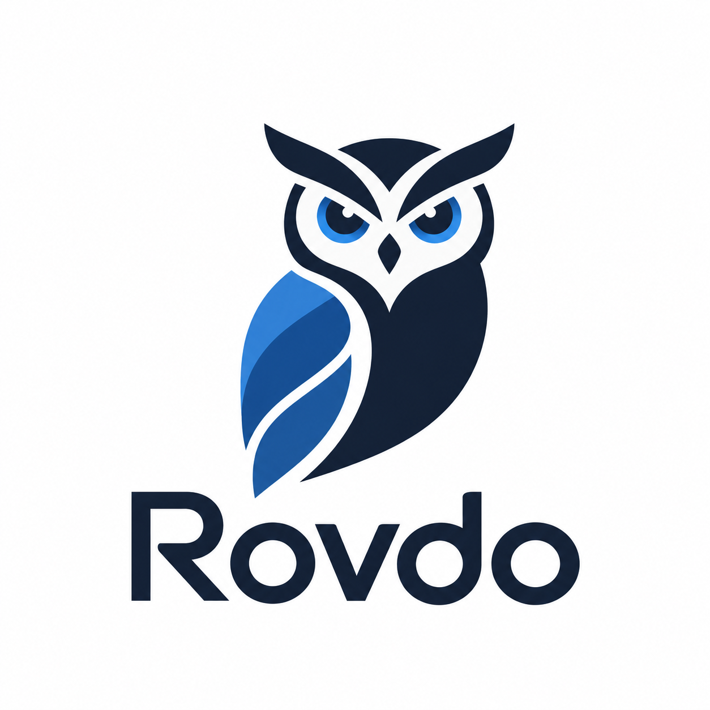

# Rovdo

<p align="center">
  <picture>
    <source media="(prefers-color-scheme: dark)" srcset="apps/desktop/src/renderer/assets/inverted_rovdo_logo.png" />
    
  </picture>
</p>

A local-first, open-source desktop workspace for AI-assisted browser workflows, with bring-your-own-model support.

Rovdo is being built to help users discover relevant jobs, prepare fact-grounded application documents, and review browser actions before submission. Its planned discovery engine uses deterministic filters and local search without requiring an AI key. Model-assisted work will use a provider selected by the user.

**Status: Desktop + BYOK developer preview.** Configure OpenAI, Anthropic, or an OpenAI-compatible endpoint; store keys in the OS credential vault; verify model capabilities; and stream chat with token usage and cost estimates. Job discovery, document generation, and browser automation are planned for later milestones.

## Quick start

Prerequisites:

- Node.js 24 LTS and npm 11. The minimum supported Node version is 22.13.
- Git and a graphical desktop session on Windows, macOS, or Linux.
- Internet access for dependency installation and the first Electron binary download.

```sh
git clone https://github.com/hamzavaid/Rovdo.git
cd Rovdo
npm ci
npm run dev
```

The app opens the workspace overview without a Rovdo account or environment file. Configuring providers does not make a network request; connection tests and chat require explicit consent. This preview does not run browser automation.

`npm run dev` builds the application and launches Electron. Restart it after source changes. To launch an existing build:

```sh
npm start
```

The build is a local development application, not an installer or signed release.

## Connect a model and chat

1. Open **Models & Privacy → New profile**. Choose a provider, enter a model ID available to your account, and set output-token and timeout limits. Hosted providers use their official endpoints. Compatible endpoints accept public HTTPS URLs or explicit loopback URLs such as `http://127.0.0.1:11434/v1`.
2. Enter the current input/output USD rates per million tokens, optional cached-input rate, and a pricing version or date. Save the profile. Rates are user maintained; no model names or prices are treated as permanent defaults. Pricing is optional for connection tests and required for budgeted chat. Use zero only for a verified free endpoint.
3. Choose **Enter API key securely**. A native password dialog sends the value directly to the privileged process and OS vault. There is no API-key input or read-key API in the web renderer. For a compatible server that requires no authentication, select **This compatible endpoint does not require an API key** instead.
4. Review the saved destination, approve the small connection-test prompt, and click **Test connection**. The test requests the read-only `workspace_info` tool with at most 128 output tokens and may incur API charges. Streaming, tools, and usage are detected from actual responses; untested features remain unknown.
5. Open **Chat**, select the profile, and set an estimated spend limit. Write a message, expand **Review outbound conversation**, and approve transmission before sending. Use **Stop response** to cancel or **New conversation** to discard in-memory context.

Chat supports text and bounded tool-call roundtrips. The only executable tool is `workspace_info`, which returns public application metadata. Model output cannot execute browser actions, shell commands, or arbitrary tools. Rendering treats responses as text.

Failed or stopped exchanges are excluded from later model context. Requests are never silently replayed; retry explicitly after resolving an error. Rate-limit `Retry-After` cooldowns are honored. Editing a destination invalidates capability results and removes its old key; enter a new key and test again.

Usage distinguishes reported tokens from unavailable accounting. Cost estimates use the saved pricing version and separate cached-input rates. Missing rates, unsupported cache-write pricing, or absent provider usage produce an unavailable estimate. Budget preflight uses a conservative token estimate and bounds tool rounds; it is not a guarantee of the provider's final bill.

## OS credential vault requirements

- **Windows:** Windows Credential Manager; native entry uses Windows Forms through the built-in Windows PowerShell. No key is passed in process arguments or environment variables.
- **macOS:** Keychain and a native hidden-answer password dialog.
- **Linux:** an unlocked Secret Service vault (for example, GNOME Keyring) and Zenity for native entry. No in-memory-keyring or plaintext fallback is used. Compatible profiles explicitly configured without authentication do not need a vault.

On Ubuntu, install native entry/vault support with `sudo apt-get install gnome-keyring zenity dbus-x11`. Run inside a graphical desktop session with a session D-Bus and unlocked keyring. An unavailable vault is reported visibly and blocks credential-dependent requests.

An optional HTTPS CONNECT proxy can be configured without embedded credentials. TLS verification stays enabled. Authenticated proxies and provider-specific transports beyond the common text/function-tool API are not supported in this preview.

## Development commands

| Command | Purpose |
| --- | --- |
| `npm run dev` | Build and open the desktop application |
| `npm run build` | Compile renderer, main process, and preload into `apps/desktop/dist` |
| `npm run lint` | Lint source and configuration with zero warnings allowed |
| `npm run typecheck` | Check strict TypeScript contracts |
| `npm test` | Run Vitest unit and boundary tests |
| `npm run test:watch` | Run unit tests in watch mode |
| `npm run test:e2e` | Verify Electron isolation, native-vault use, settings restart, and mock-provider chat |
| `npm run check` | Run lint, typecheck, unit tests, build, and desktop smoke |

Build before running E2E tests directly. Playwright drives Electron itself; no additional browser download is required. Tests use synthetic credentials in the real OS vault and remove them afterward. Provider HTTP responses are mocked or served by an explicit loopback fixture; no paid provider requests are made. On headless Linux, install system libraries and run an isolated D-Bus/keyring session with a virtual display:

```sh
npx playwright install-deps chromium
sudo apt-get install gnome-keyring zenity dbus-x11 libdbus-1-3
dbus-run-session -- sh -c 'printf "rovdo-ci-fixture\n" | gnome-keyring-daemon --unlock --components=secrets; xvfb-run --auto-servernum npm run check'
```

CI is configured to run these checks on Windows, macOS, and Linux, plus a dependency audit. Local acceptance has been verified on Windows; other platforms require their CI results before release.

## Project structure

```text
apps/desktop/         Electron main, sandboxed preload, React renderer
packages/shared/      Zod contracts, shared types, error codes
packages/agent-core/  Safe structured diagnostics; future runtime boundary
packages/providers/   Provider-independent gateway and official SDK adapters
packages/storage/     SQLite WAL migrations, provider settings, numeric usage
tests/e2e/            Electron and native-vault checks using synthetic data
scripts/              Build and launch helpers
.github/workflows/    Cross-platform CI
```

The stack is Electron, React, TypeScript, Vite, Zod, Vitest, and Playwright Test. Runtime and tooling versions are pinned in the workspace manifests and lockfile. Additional modules will be introduced with their development milestones.

## Privacy and security

The renderer has no Node access and no direct network access. Its isolated preload exposes specific, schema-validated settings/chat methods; every privileged request checks the owning window and main frame. The local asset protocol restricts file access; navigation, new windows, and device permissions are blocked. Application diagnostics accept only predefined metadata fields and do not serialize arbitrary messages or errors.

Provider settings, capability results, and numeric usage/cost records persist in `rovdo.sqlite` under Electron's application user-data directory. Keys stay in the OS vault, scoped to a profile and destination. SQLite is not encrypted; it contains no key values or chat messages. Chat history stays in memory and is cleared when its window closes. Electron also creates normal local runtime/cache files.

There is no analytics or applicant database. Hosted providers receive the conversation you explicitly approve; their own retention policies apply. Main-process requests validate destinations, pin public DNS results, reject redirects and LAN/metadata targets, and isolate explicit loopback endpoints. SDK logging and tracing are disabled; ambient credential/header settings cannot replace the selected vault key. Local-first storage does not imply local inference.

See [SECURITY.md](SECURITY.md) for vulnerability reporting and [CONTRIBUTING.md](CONTRIBUTING.md) for development practices.

## License

Rovdo's original code is available under [Apache-2.0](LICENSE). Dependencies retain their respective licenses.
